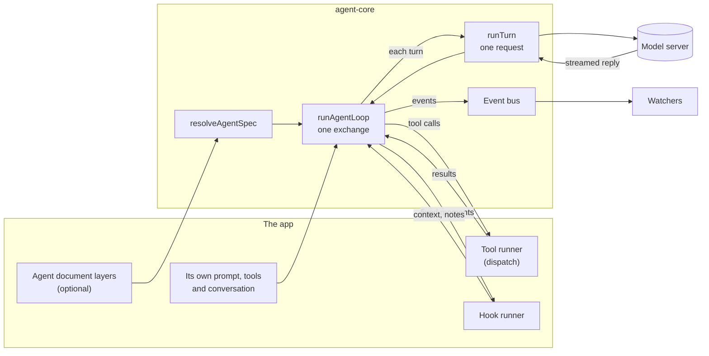
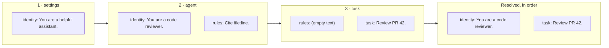
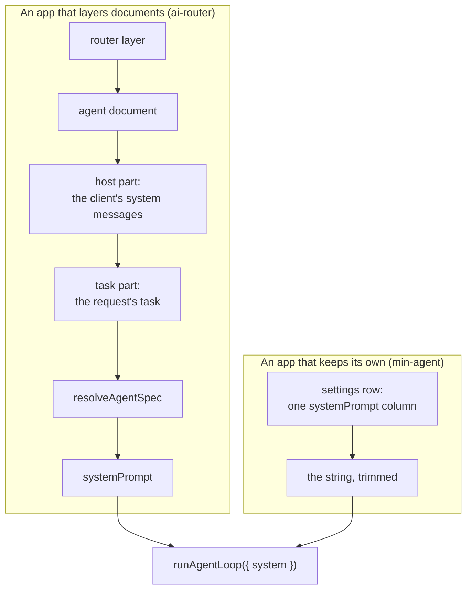
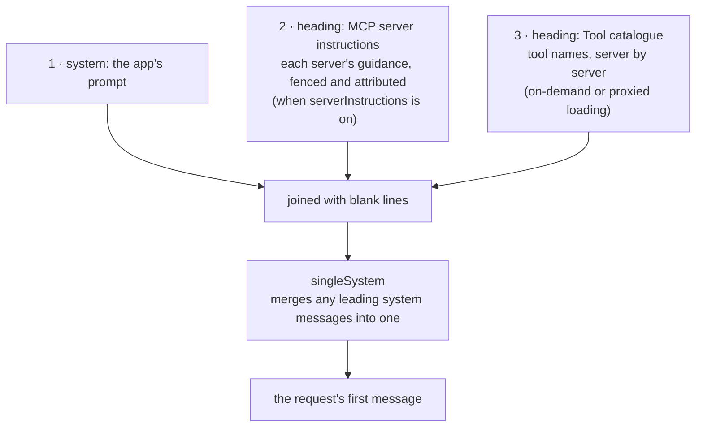
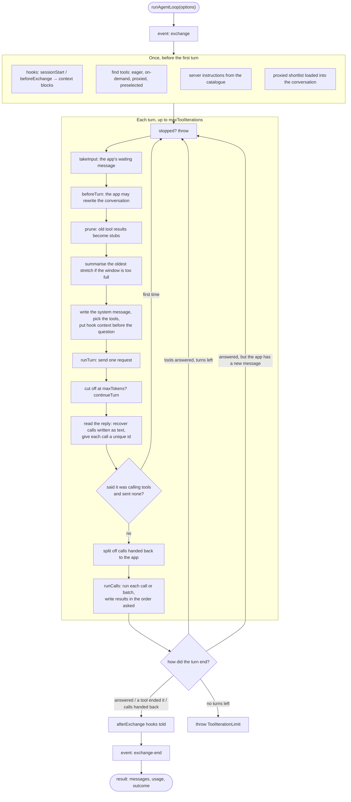
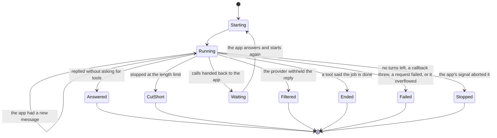
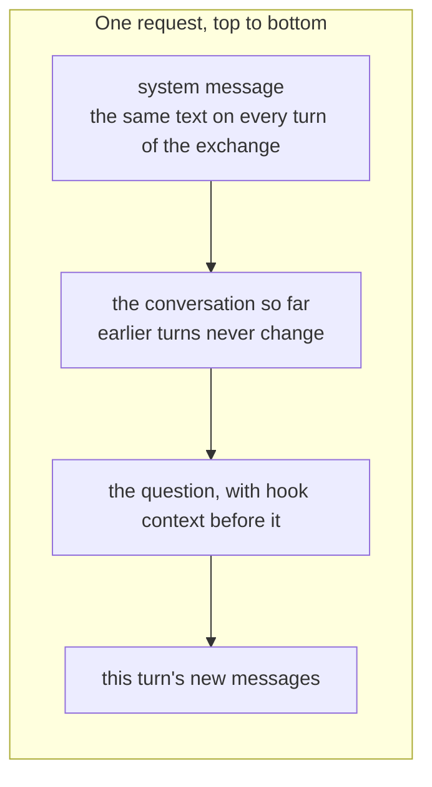

# How agent-core works

Diagrams of what the package does today: how an app's prompt reaches the model, what one
exchange does turn by turn, and how one request is sent. The words are the glossary's, in
[`.agents/domain-model.md`](.agents/domain-model.md); the code each step names is the place to
read for how.

- [The pieces](#the-pieces)
- [From prompt parts to a system prompt](#from-prompt-parts-to-a-system-prompt)
- [What the model is sent](#what-the-model-is-sent)
- [One exchange](#one-exchange)
- [One request](#one-request)
- [How an exchange ends](#how-an-exchange-ends)
- [What keeps the prompt cache warm](#what-keeps-the-prompt-cache-warm)

## The pieces

The work comes in four sizes: a **session** holds **runs**, a run holds **exchanges**, and an
exchange is a series of **turns**, each one model reply plus the tools it asked for.



The package never knows what the run is for. The prompt, the tools and what a tool call does
are the app's.

## From prompt parts to a system prompt

An agent document's `prompt` is a list of **prompt parts**, each `{ id, text }` or
`{ id, ref }`. An app stacks documents weakest first, for example settings, then the agent,
then a task, and `resolveAgentSpec` merges the parts by id:

- a new id adds a part, after those already there;
- the same id replaces the part in the place it first had;
- an empty `text` deletes the part, with everything below it.



The resolved agent keeps the merged list as `prompt`, ids and references included, and joins
the texts into `systemPrompt`:

```ts
systemPrompt = prompt.map((part) => part.text?.trim() ?? '').filter(Boolean).join('\n\n');
```

The ids decide merging and order; the model never sees them. A `ref` part adds nothing to
`systemPrompt`: references are never fetched, so an app that wants one resolves it itself.

### Two ways an app hands its prompt to the loop

The loop takes the system prompt as one string, its `system` option. Whatever parts the app
had are already joined when it arrives.



An app's documents only matter at this step. Once the loop has `system`, it treats it as text
and never splits or rewrites it.

## What the model is sent

The loop writes the system message on every turn, in one place (`runTurns`,
`src/run/agent-loop.ts`), in this order:



When neither section applies, `system` is sent exactly as it was given. Each server's guidance
is wrapped as

```
## <server label>

<untrusted source="<server label>">
…
</untrusted>
```

and text inside it cannot close its own fence. The catalogue is left out on a turn whose tools
a preselection already chose.

Where everything else goes:

| What | Where in the request | When it is written |
| --- | --- | --- |
| The app's prompt, server instructions, catalogue | The system message | The same text on every turn of an exchange |
| Hook context (`sessionStart`, `beforeExchange`) | Before the question, in the user's message, as `<context source="…">` blocks after a short preface | Once per exchange, on the request only, never in the stored transcript |
| The conversation | The messages after the system message | Grows by appending each turn |
| Input the app sent mid-exchange | A new message in the conversation | Between turns |
| Tools | The `tools` array, sorted by name unless `toolOrder` is `false` | Per turn: which tools depends on the loading mode |

Which tools a turn declares:

| Loading mode | Tools declared |
| --- | --- |
| Eager | Every tool, plus the app's own |
| On-demand | `load_tools`, the tools loaded so far, and the app's own |
| Proxied | `load_tools` and `call_tool`, which never change, and the app's own; definitions load into the conversation |
| Preselected, first turn | The shortlist and the app's own, unless `preselectRouting` is `append` |

## One exchange



The events the loop sends along the way include `turn`, the streamed `thinking` and `output`,
each call and result, `usage` per turn, `wait` when calls are handed back, and notices.

## One request

`runTurn` is the retry loop around the negotiation around the stream.

```mermaid
sequenceDiagram
  autonumber
  participant Loop as runAgentLoop
  participant Turn as runTurn
  participant Neg as negotiate
  participant Srv as Model server

  Loop->>Turn: build(supported, refused), options
  Turn->>Turn: size the request against contextLimit (at most once)
  loop until answered or out of retries
    Turn->>Neg: send
    Neg->>Srv: streamed request, without what it refused before
    alt the server refuses a feature or field
      Srv-->>Neg: refusal
      Neg->>Neg: latch it off, rebuild the body
      Neg->>Srv: resend
    else the model is still loading
      Srv-->>Turn: loading
      Turn->>Turn: wait, ask again (not a retry)
    else lost, timed out or busy
      Srv-->>Turn: error
      Turn->>Turn: back off, resend (one retry spent)
    else the reply streams in
      Srv-->>Turn: chunks
    end
  end
  Turn-->>Loop: reply, tool calls, usage
```

A reply that has produced anything is never sent again, and a request too big for the window
fails as `ContextOverflow` whichever side finds out.

## How an exchange ends



Every way out sends one `exchange-end` event, a failed or stopped exchange just before it
throws.

## What keeps the prompt cache warm

A model server reuses the longest prefix a request shares with the one before it, so the
request is built to change only at its end.



- The system message is written from the same inputs each turn, and loading a tool does not
  change the catalogue's text: what is loaded is said in the tool array and the `load_tools`
  result instead.
- Hook context goes on the request, never into the system prompt or the stored transcript.
- Tools are sorted by name unless `toolOrder` is `false`, so the same set always reads the same.
- Pruning moves its boundary only forward, so between moves each request extends the last.
- Between exchanges, the first prompt part that differs is where reuse stops: everything after
  it, the server instructions and catalogue included, is read again.

The token ledger records each request's size and, when a cache falls short of the one before,
its likely cause (`cacheDiagnosis`).
